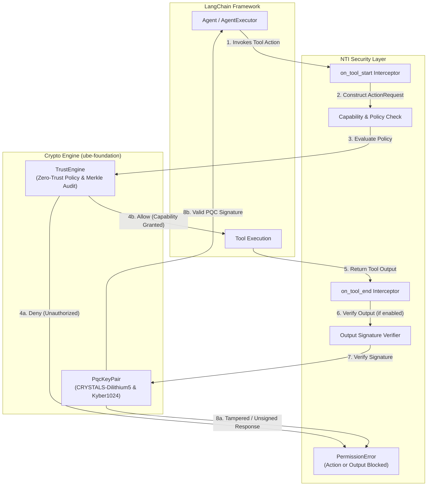

[](https://nti-registry.vercel.app)

# langchain-nti

**Full 5-pillar post-quantum security for LangChain agents, powered by NTI (Neutral Trust Infrastructure).**

[](https://pypi.org/project/langchain-nti/)
[](https://www.apache.org/licenses/LICENSE-2.0)
[](https://www.python.org/downloads/)

## Installation

```bash
pip install langchain-nti ube-foundation langchain-core
```

## Quick Start — Drop-In Security Callback

```python
from langchain_core.tools import tool
from langchain_nti import NTICallbackHandler, NTISecurityLayer

# Instantiate NTI security handler
handler = NTISecurityLayer(agent_id="finance_agent")

# Grant explicit zero-trust capability
handler.grant_capability("execute_transfer")

@tool
def execute_transfer(amount: int) -> str:
    """Executes a financial transfer."""
    return f"Transferred ${amount} successfully"

# Execute tool with NTI callback attached
response = execute_transfer.invoke({"amount": 100}, config={"callbacks": [handler]})
print(response)  # "Transferred $100 successfully"
```

## Verifying Tool Output Signatures

```python
# Enable tool response verification on the handler
handler = NTICallbackHandler(
    agent_id="secure_agent",
    strict=True,
    verify_tool_responses=True,
)

# Sign a response payload
signed_payload = handler.sign_output("Sensitive bank balance data")

# Verify payload signature
is_valid = handler.verify_output(signed_payload)
print("Signature valid:", is_valid)  # True
```

## What It Enforces — All 5 Pillars of NTI

| Pillar | What It Does |
|---|---|
| **1. Zero-Trust Capability Enforcement** | Agents have zero inherent permissions. Every action requires an explicit capability grant, evaluated in real-time. |
| **2. NIST Post-Quantum Cryptography** | Every request is signed with CRYSTALS-Dilithium5 (NIST Level 5). Envelope encryption uses CRYSTALS-Kyber1024 + ChaCha20Poly1305. |
| **3. BFT Multi-Agent Consensus** | Multi-agent decisions require threshold signature collection. Prevents single-agent prompt injection and rogue agent behavior. |
| **4. Merkle-Chained Audit Trails** | Every evaluated action is hashed into a SHA-256 Merkle audit chain. Tamper-proof compliance logs. |
| **5. P2P Agent Mesh & State Persistence** | Cryptographic agent identity, key rotation, and X25519 DH handshakes. Audit trails persist to disk and self-verify on reload. |

## BFT Consensus Example

```python
handler.register_voter_key("voter_01", voter_public_key_bytes)
handler.register_voter_key("voter_02", voter_public_key_bytes)
# Multi-agent consensus enforced automatically on evaluation.
```

## Why NTI

Autonomous LLM agents are prone to prompt injection, hallucinated function calls, and unconstrained action execution. NTI provides a cryptographically verifiable execution barrier in <1ms overhead, ensuring agents cannot execute unauthorized actions even if compromised at the prompt level.

## License

Apache License 2.0. See [LICENSE](LICENSE).

## Links

- Core SDK (PyPI): https://pypi.org/project/ube-foundation/
- Core SDK (crates.io): https://crates.io/crates/ube-foundation
- Homepage: https://abisheakp197.github.io/Neutral-Trust-Infrastructure/
- Whitepaper: [WHITEPAPER.md](./WHITEPAPER.md)

## Architecture


